  

<h2 align="center">Hey, I'm Smokiestfox 👋</h2>

  I'm working toward becoming a <strong>Backend Developer</strong>. 
  I enjoy exploring practical ideas and turning them into useful software.

 

<h3 align="center">Languages &amp; tools</h3>

  

  Java · TypeScript · Python · JavaScript · C++ · Docker · Figma

 

<h3 align="center">Let's connect</h3>

  <a href="mailto:ngongoquychinh@gmail.com">ngongoquychinh@gmail.com</a>

 

  

