  

  

  Aspiring <strong>Backend Developer</strong>, interested in practical software ideas. 
  Currently building a restaurant ordering API with NestJS and PostgreSQL.

 

<h3 align="center">Building in practice</h3>

  <strong>Food Order System</strong> 
  A restaurant ordering application with a NestJS API and PostgreSQL. 
  <a href="https://github.com/Smokiestfox/food-order-system-backend">Backend</a> ·
  <a href="https://github.com/Smokiestfox/food-order-system-frontend">Frontend</a> ·
  <a href="https://github.com/Smokiestfox/food-order-system-backend/blob/main/docs/ARCHITECTURE.md">Architecture &amp; ERD</a>

 

<h3 align="center">Languages &amp; tools</h3>

  

  Java · TypeScript · Python · JavaScript · C++ · Docker

 

<h3 align="center">Databases</h3>

  

  SQLite · PostgreSQL · MySQL

 

<h3 align="center">Currently learning</h3>

  

  NestJS · Next.js

 

<h3 align="center">Contribution</h3>

  <picture>
    <source media="(prefers-color-scheme: dark)" srcset="https://raw.githubusercontent.com/Smokiestfox/Smokiestfox/output/github-snake-dark.svg" />
    <source media="(prefers-color-scheme: light)" srcset="https://raw.githubusercontent.com/Smokiestfox/Smokiestfox/output/github-snake.svg" />
    
  </picture>

 

<h3 align="center">Let's connect</h3>

  <a href="mailto:ngongoquychinh@gmail.com">ngongoquychinh@gmail.com</a>

 

  

